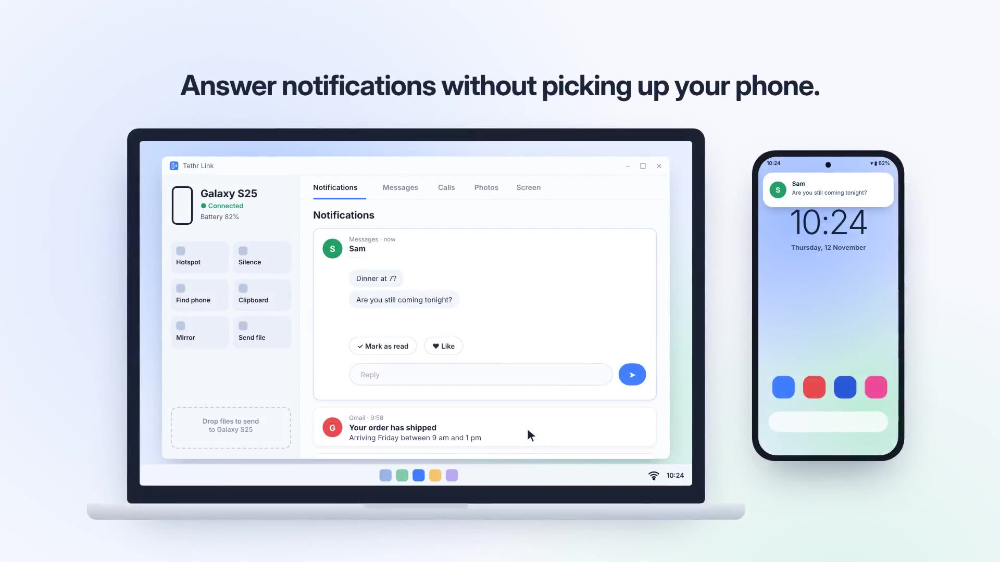

# Pixlink 

Website: https://fatalquackers.github.io/pixlink/ 

**Your Pixel, on your Windows PC.** Pixlink is a free, open-source companion app that links a Google Pixel phone to a Windows PC: notifications and texts, screen mirroring with control, one-click hotspot, calls through your PC, your photo gallery and your phone's files.

> Pixlink is an independent open-source project. It is not made by, affiliated with, or endorsed by Google or Microsoft. "Pixel" is a trademark of Google LLC.

[](https://fatalquackers.github.io/pixlink/#trailer)

**[Watch the trailer](https://fatalquackers.github.io/pixlink/videos.html)**: the launch trailer, a 29-second hype cut and a setup guide, each in widescreen and vertical.

## Features

| Feature | Works for everyone | Power mode adds |
| --- | --- | --- |
| Notifications | Expand a card to read the whole message and chat, reply, press the app's own buttons (Mark as read, Like…) or **Open on phone** (opens the app and shows your phone screen); group by app; pin to Home; Windows pop-ups with Reply, app buttons and Dismiss | — |
| Messages | **Chats** from every app (texts, WhatsApp, Discord, Outlook…) with app icons and clickable links; **Texts**: your SMS history read straight from your phone, no Google sign-in; pin, mark as read, remove | — |
| Screen mirroring | See your phone screen live, choose quality; with **Screen control** on (no Power mode needed) click, swipe, scroll, type and use Back/Home/Recents. Sharing stops when Pixlink is minimized. | Faster input |
| Hotspot | One button: your phone shows a notification that opens its hotspot switch, PC joins automatically | Phone switches the hotspot on by itself |
| Calls | Dialer, contacts, calls through your PC's Bluetooth | Call history |
| Photos & files | Full gallery, drag files both ways, shared folders | Browse all phone storage |
| Now playing | See what's playing on your phone; play, pause, skip | — |
| Find my phone | Ring it at full volume, even on silent | — |
| Do Not Disturb | Turn Do Not Disturb on or off from your PC | — |
| Clipboard | Copy on your PC, paste on your phone (automatic). From the phone: "Send clipboard" in Pixlink's notification or quick settings tile. **Sign-in codes** from your phone are copied on your PC automatically | — |
| Quick actions | Choose which buttons show (Hotspot, Screen, Send file, Find phone, Clipboard, Do not disturb, Photos, Messages…) | Lock phone, Screenshot |
| Send to PC | Share text, links, photos and files from any app to your PC | — |
| Battery | Low battery alert on your PC | — |

**Linking** takes seconds: scan the QR code or type the 5-digit code shown on your PC. One phone can link to **several PCs** (say, a work laptop and a home PC); it stays connected to all of them at once. Tap **Link another PC** on the phone's home screen.

**Power mode** uses [Shizuku](https://shizuku.rikka.app/) and a one-time Wireless Debugging pairing. It's optional. See [docs/POWER_MODE.md](docs/POWER_MODE.md).

### Settings

- **PC:** PC name, theme, start with Windows, pop-ups (on/off, message text, sound, per app), low battery alert level, hotspot details, screen mirroring quality / frame rate / bitrate, automatic updates.
- **Phone:** device name, which apps send notifications, hide private message text, what your PC is allowed to do (ring, clipboard, music, Do Not Disturb), hotspot details, shared folders, background running, updates, welcome tour.

## How to install

Pixlink isn't on Google Play yet, so for now you install it from this page. It takes about 5 minutes.

**Prefer to watch?** [Watch the setup guide](https://fatalquackers.github.io/pixlink/videos.html#setup).

**You need:** a Google Pixel on Android 13 or newer, a Windows 10 or 11 PC, and both on the same Wi-Fi.

### 1. Install on your Pixel

1. On your phone, open the [latest release](https://github.com/FatalQuackers/pixlink/releases/latest) and tap **Pixlink-android.apk** to download it.
2. Open the downloaded file. If your phone asks, allow your browser to **install unknown apps**.
3. Tap **Install**. If Google Play Protect warns you, tap **More details → Install anyway** (this happens because the app isn't on the Play Store yet).
4. Open Pixlink and go through **Setup**: Notification access, Calls/contacts/photos, Texts and Screen control. Pixlink shows where to find it in each list.
   - If Android says **"Restricted setting"** (it does for every app installed from a file), open **App info → ⋮ → Allow restricted settings**, then try again. Pixlink's **Open app info** button takes you there.
   - Play Protect or "unverified developer" warnings: see [docs/OFFICIAL.md](docs/OFFICIAL.md).

### 2. Install on your Windows PC

Pick one:

- **Installer (recommended):** download **Pixlink-Setup-x64.exe** from the [latest release](https://github.com/FatalQuackers/pixlink/releases/latest) and run it. No admin needed. It adds Start menu and desktop shortcuts, can start Pixlink when you sign in, and shows up in Windows' Installed apps so you can uninstall it.
- **Portable:** download **Pixlink-windows-x64-portable.zip**, right-click → **Extract All** anywhere (even a USB stick) and run **Pixlink.exe**. Its settings stay in a `Data` folder next to it, and it leaves nothing behind on the PC.

Then:

1. If Windows SmartScreen appears, click **More info → Run anyway**.
2. When Windows Firewall asks, tick **Private networks** and click **Allow**. Pixlink needs this to talk to your phone.
3. After linking, Pixlink asks a few setup questions (start with Windows, pop-ups, clipboard, theme). You can change them later in Settings.

### 3. Link them

1. On your PC, Pixlink shows a QR code and a 5-digit code.
2. On your Pixel, open Pixlink. After the short welcome tour, tap **Scan QR code** and point the camera at your screen, or tap **Enter 5-digit code** and type it.
3. Done. Your notifications appear on your PC within a few seconds.

### Try the phone app on your PC first (Android emulator)

You can test the Android app without installing it on your phone, using Google's free Android emulator.

1. Install [Android Studio](https://developer.android.com/studio) and open it.
2. Click **More Actions → Virtual Device Manager → Create device**. Pick **Pixel 8**, then a system image with API 35, and click **Finish**. Press ▶ to start it.
3. Drag **Pixlink-android.apk** onto the emulator window to install it.
4. Open Pixlink on your PC and click **Copy link** under the QR code.
5. In the emulator, open Pixlink, tap **Scan QR code**, then tap **Paste pairing link**. The emulator shares your PC's clipboard.

The emulator has no real phone calls or photos, but pairing, notifications and screen mirroring all work.

### Optional extras

- **Calls through your PC:** pair your phone with your PC in **Windows Settings → Bluetooth & devices → Add device**.
- **Hotspot:** click **Hotspot** in the PC app. The first time, it asks for your phone's hotspot name and password. With Power mode on, your phone's hotspot switches on by itself and your PC joins it; without Power mode, your phone shows a notification. Tap it and flip the hotspot switch, and your PC joins by itself.
- **Power mode** (screen control, hotspot toggle, call history, all files): follow [docs/POWER_MODE.md](docs/POWER_MODE.md).

### Troubleshooting

- **Pixlink doesn't open on Windows:** download the newest release. If it still won't start, it shows an error and saves details to `%LOCALAPPDATA%\Pixlink\crash.log`; please attach that file to a [GitHub issue](https://github.com/FatalQuackers/pixlink/issues).
- **It connects, then drops straight away:** update to the newest release on both phone and PC. The phone's home screen shows the reason for the last disconnect; please include it if you report a problem.
- **The phone can't find the PC:** check both are on the same Wi-Fi (not a guest network), and that Pixlink is allowed in Windows Firewall on private networks.
- **The QR code expired:** click **Get a new code** on your PC.
- **Notifications stopped:** on your phone, check Pixlink still has notification access, and that battery saver isn't stopping it.
- **Something else:** on your PC, Settings → **View logs** shows what Pixlink did. Copy them into a GitHub issue.

### Updates

Both apps update themselves. You don't need to download anything again.

- **PC:** Pixlink checks when it starts and every 6 hours, installs the new version and restarts. It never updates during a call or while mirroring your screen. (Settings → Install updates automatically.)
- **Phone:** new versions download and install by themselves. With Power mode on, it's completely silent. Without it, Android asks you to allow Pixlink to install updates once, and shows one confirmation the first time; after that, updates install silently. Pixlink reconnects to your PC afterwards.

### Uninstall

- **Pixel:** long-press the Pixlink icon → **Uninstall**.
- **PC (installer):** Settings → Apps → Installed apps → Pixlink → **Uninstall**. To remove its settings too, delete `%LOCALAPPDATA%\Pixlink`.
- **PC (portable):** quit Pixlink (right-click the tray icon → Quit) and delete its folder.

## Repo layout

```
android/   Pixel app — Kotlin + Jetpack Compose (Android 13+)
windows/   PC app — C# + WinUI 3 / Windows App SDK (Windows 10 22H2+ / 11)
docs/      Protocol spec, Power mode guide
website/   Project website (GitHub Pages)
```

## How it works

1. The Windows app shows a QR code with its local IP, port, a one-time token and its certificate fingerprint.
2. The Pixel scans it and connects over your Wi-Fi using TLS. Both sides pin each other's certificate. No accounts, no cloud.
3. Messages travel as JSON over TLS (port 47100). Screen video is a separate H.264 stream (port 47101).
4. Call audio uses Bluetooth, with the PC acting as a headset.

Full details: [docs/PROTOCOL.md](docs/PROTOCOL.md).

## Building from source

- **Android:** open `android/` in [Android Studio](https://developer.android.com/studio) and press **Run** with your Pixel plugged in (USB debugging on).
- **Windows:** open `windows/Pixlink.sln` in [Visual Studio 2022](https://visualstudio.microsoft.com/) with the **Windows application development** workload, set the platform to **x64**, and press **F5**.

Every push to `main` is built automatically by GitHub Actions and published as a release.

## Releases

Download the latest version from [Releases](https://github.com/FatalQuackers/pixlink/releases/latest). Both apps check for updates by themselves.

To publish a new version: create a release on GitHub with a tag like `v1.0.1` (or push that tag). GitHub Actions builds both apps and attaches them to the release.

## Contributing

PRs welcome! See [CONTRIBUTING.md](CONTRIBUTING.md).

## Support the project

Pixlink is free forever. If it helps you, consider sponsoring development.

## License

[MIT](LICENSE)
